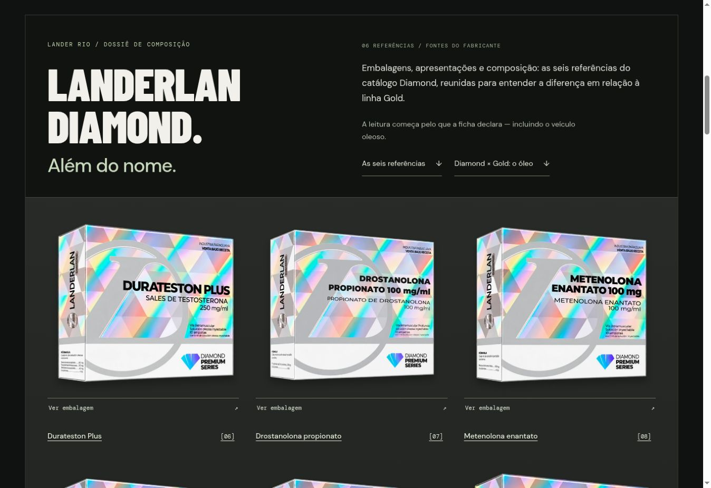
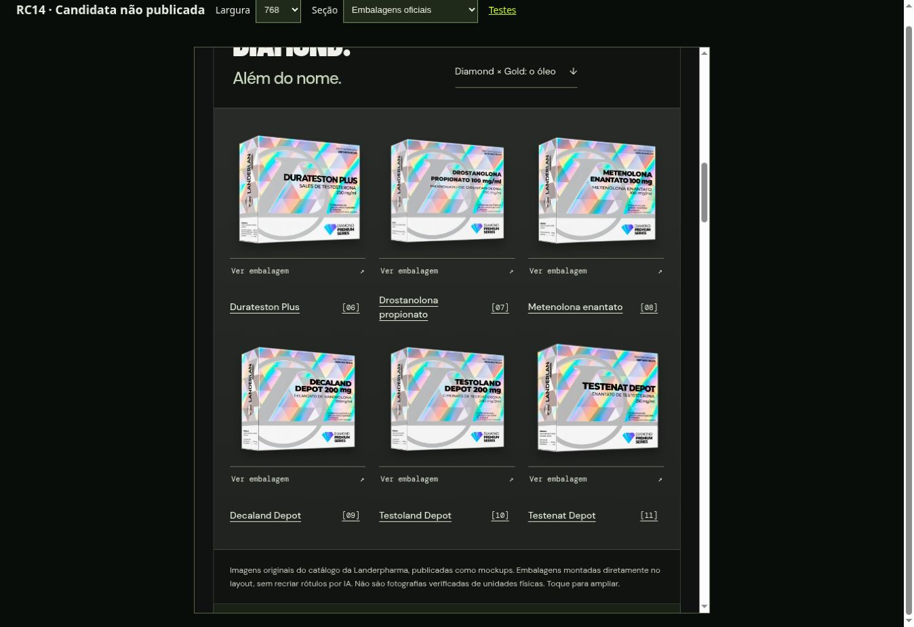
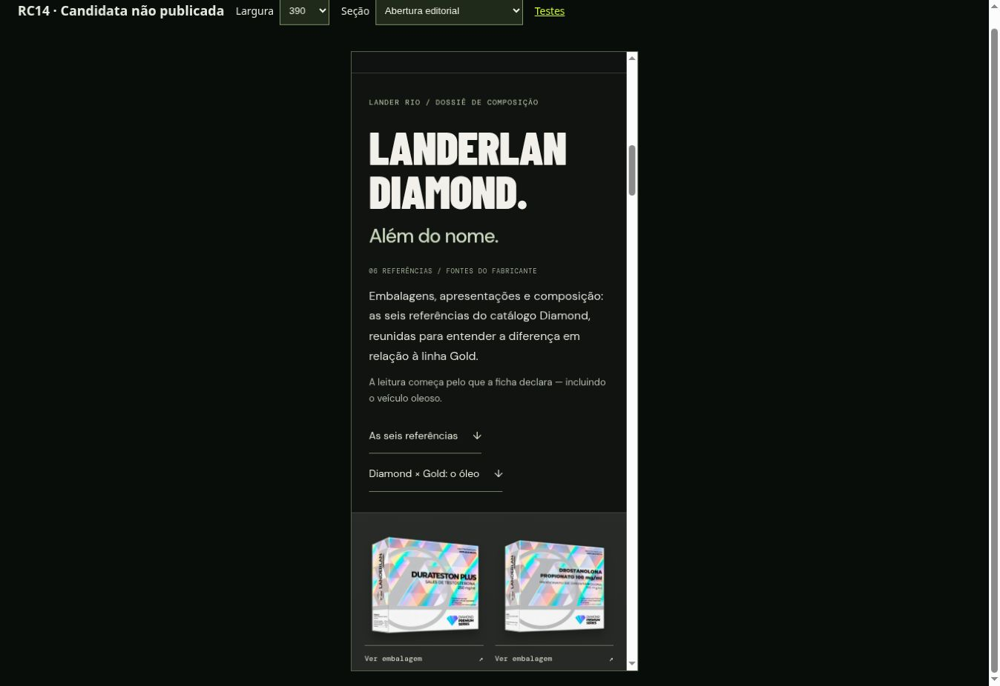
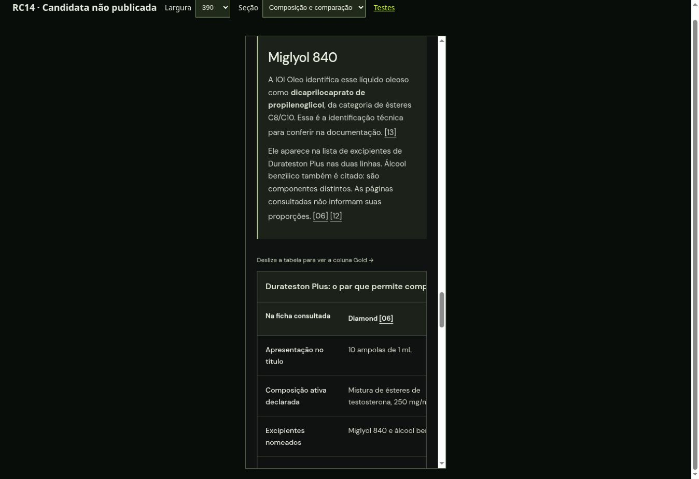

# Diamond e Gold — RC14 / seção editorial concluída

A página existente `/marcas/landerlan/` apresenta as seis embalagens do catálogo Diamond, a identificação de cada referência e uma comparação de composição limitada ao que as fontes documentam. As imagens vieram das fichas individuais da Landerpharma. O fabricante as publica como **mockups**: não são fotografias verificadas de unidades físicas. Não houve geração de embalagens por IA, alteração de rótulos, recorte de produtos ou efeitos promocionais.

## Seção implementada

A revisão `editorial-section-v3` monta as seis embalagens originais diretamente em HTML/CSS, sobre um fundo neutro contínuo. A abertura identifica Landerlan Diamond, apresenta o escopo documental e conduz às referências e ao comparativo do óleo. Desktop com três colunas; celular com duas. Os rótulos não são reescritos ou gerados. As duas composições experimentais por IA não foram incorporadas ao site.

Os 12 arquivos de imagem (seis prévias e seis ampliações) permanecem idênticos ao commit `678b26f6a6adcd5d611dffb8be3586a3051be6c9`. [Hashes e idempotência](evidence/diamond-2026-11-15/editorial-section-v3/source-preservation.json).

## Imagens utilizadas

Durateston Plus, Drostanolona propionato, Metenolona enantato, Decaland Depot, Testoland Depot e Testenat Depot. Cada imagem tem texto alternativo, link para ampliação local em 1278 × 1230 px, identificação e referência à ficha de origem.

As seis prévias WebP de 640 × 616 px somam **383.360 bytes**. Usam carregamento lazy e dimensões explícitas. As ampliações são WebP sem perdas: a transparência e os pixels renderizados sobre branco e preto são idênticos aos PNGs baixados. As prévias foram redimensionadas proporcionalmente e comprimidas em qualidade 90; não são declaradas pixel a pixel idênticas.

[Proveniência, URLs originais e hashes](../content/diamond-image-provenance.json) · [Comparação de pixels](evidence/diamond-2026-11-15/manufacturer-images-v2/image-integrity.json)

A arte abstrata da primeira candidata foi retirada da página. O arquivo e as evidências anteriores continuam preservados no histórico. A galeria é uma referência editorial; não contém oferta, preço, compra, WhatsApp, posologia ou promessa clínica.

## Composição documentada

As fichas de Durateston Plus Diamond e Gold nomeiam Miglyol 840 e álcool benzílico. Isso não estabelece proporções idênticas, equivalência entre lotes ou superioridade clínica. O veículo não foi identificado nominalmente nas outras cinco páginas Diamond consultadas. A IOI Oleo identifica Miglyol 840 como dicaprilocaprato de propilenoglicol; não foram inferidas menor dor, maior absorção ou segurança comparativa.

- [Catálogo Diamond](https://landerpharma.com.py/linea-diamond)
- [Durateston Plus Diamond](https://landerpharma.com.py/productos/durateston-plus-10-ampollas-x-1-ml)
- [Durateston Plus Gold](https://landerpharma.com.py/productos/durateston-plus-gold-fco-amp-x-10-ml)
- [IOI Oleo — Miglyol 840](https://www.ioioleo.de/en/pharma/products-pharma/miglyol-840/)
- [Matriz completa](../content/diamond-gold-evidence.json)

As URLs de Testoland e Testenat têm volumes diferentes dos títulos. A redação e a conferência das imagens seguem títulos, fórmulas e apresentações: Testoland, 2 mL; Testenat, 1 mL. Os endereços originais foram preservados.

## Alterações desta revisão

| Arquivo | Alteração |
|---|---|
| `site/marcas/landerlan/index.html` | Galeria de seis imagens, ampliações, atribuição e âncoras individuais |
| `site/assets/editorial/diamond/` | Seis prévias leves e seis ampliações sem perdas |
| `site/assets/diamond-editorial-rc14.css` | Galeria de três colunas no desktop e duas no celular, sem cortar embalagens |
| `content/diamond-image-provenance.json` | Origem, tipo de imagem, hashes, dimensões e conversões |
| `scripts/build_diamond_editorial.py` | Geração idempotente e associação estrita entre imagem e produto |
| Testes editoriais e harness de navegador | Verificação de seis imagens, fontes, ampliações, links e responsividade |
| `site/release.json` e manifesto RC14 | Revisão `editorial-section-v3`; hashes atualizados |

## Validação desta revisão

- **45/45 blocos técnicos aprovados**, incluindo **150 testes Node e 7 testes editoriais**.
- **64/64 verificações de navegador aprovadas** em Chromium, nas larguras 320, 390, 768 e 1440 px. As seis prévias e as seis ampliações carregaram em cada largura.
- Integridade: **88 páginas**, **4.742 referências HTML locais** e **46 URLs no sitemap**, sem problemas detectados pelo verificador.
- Rótulos dos seis arquivos de origem conferidos visualmente. Galeria revisada em 320, 390, 768 px e desktop; ampliação de Durateston também acionada manualmente.
- Comparação dos pixels visíveis e transparência das seis ampliações: **6/6 aprovadas**. Regeneração mantém bytes de página, release e dados de marca.
- Axe: **zero violações detectadas** nas quatro análises. Permanecem **quatro resultados incompletos de contraste, totalizando 116 nós**. A galeria usa gradiente; o cálculo independente da cor declarada dos textos contra os dois extremos confirma razão superior a 4,5:1 ([cálculo](evidence/diamond-2026-11-15/editorial-section-v3/gallery-contrast.json)). Os resultados incompletos do restante da página continuam sem certificação integral.
- Nenhum formulário real enviado, deploy ou publicação executado. O harness e as evidências ficam fora de `site/`.

[Gate técnico](evidence/diamond-2026-11-15/editorial-section-v3/validation/validation.json) · [Navegador](evidence/diamond-2026-11-15/editorial-section-v3/browser-results.json) · [Idempotência](evidence/diamond-2026-11-15/editorial-section-v3/source-preservation.json)

## Evidências visuais

## Estado de entrega e limites

Revisão no mesmo PR14 e na branch `editorial/diamond-gold-2026-11-15`, sobre `seo/organic-growth-2026-11-14` / PR13. A primeira revisão está preservada no commit `fd18fad4e5829c0b79a247882ee2994c1d6ca9e1`. A produção observada é RC10, deploy `6af804d36034a689af84dddf`; esta candidata RC14 não foi publicada. Não substituir a produção diretamente pela antiga `main`.

Pendências reais: fotografias de unidades físicas não foram fornecidas; o material disponível são os mockups oficiais. Continuam sem comprovação documental o veículo dos outros cinco produtos e a regularidade de comercialização no Brasil. Não foram realizados revisão clínica/regulatória externa, teste em Safari/iPhone físico ou medição de ganhos orgânicos. A publicação depende de autorização específica.

## Reprodução

Executar `python3 scripts/build_diamond_editorial.py`, `python3 scripts/build_rc14_manifest.py` e `python3 scripts/validate_titan.py --out docs/evidence/diamond-2026-11-15/editorial-section-v3/validation`. As fontes e transformações de cada imagem estão na matriz de proveniência.

O servidor de QA aceita apenas loopback. Abrir `/__qa/diamond.html` para executar os testes e `/__qa/diamond-visual.html` para revisão. A ferramenta de QA não integra o pacote publicado.
