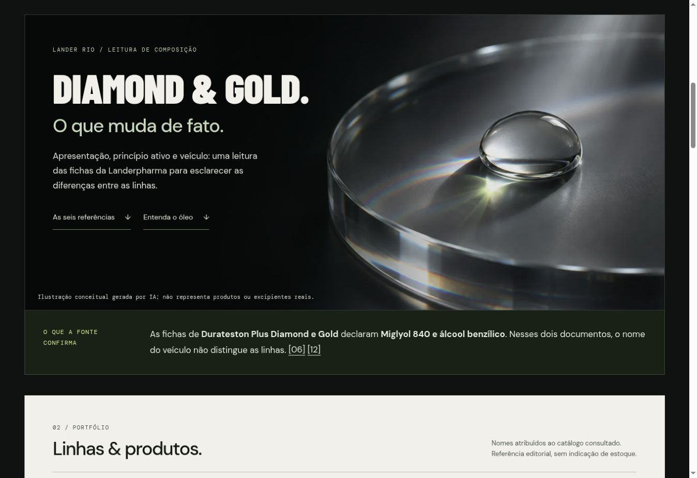
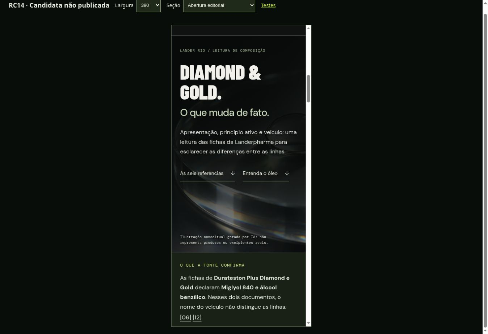
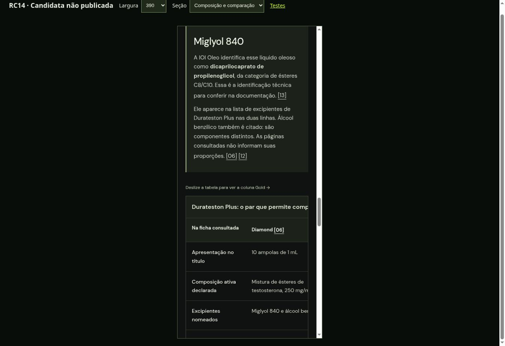

# Diamond e Gold — seção editorial RC14

A página existente `/marcas/landerlan/` recebeu uma abertura visual, seis referências documentadas e uma comparação de composição. O material é educativo: não contém oferta, preço, WhatsApp de compra, promessa clínica ou recomendação de uso. A arte é conceitual e está identificada como tal; não é fotografia da linha de medicamentos.

## Resultado verificável da pesquisa

A página Diamond da Landerpharma lista seis referências na consulta de 15/11/2026: Durateston Plus, Drostanolona propionato, Metenolona enantato, Decaland Depot, Testoland Depot e Testenat Depot. Cada referência agora aponta para sua ficha individual.

As fichas de Durateston Plus Diamond e Gold nomeiam os mesmos dois excipientes: Miglyol 840 e álcool benzílico. Isso não estabelece proporções idênticas, equivalência entre lotes ou superioridade clínica. O óleo não foi identificado nominalmente nas outras cinco páginas Diamond consultadas. A identidade química de Miglyol 840 foi conferida na documentação da IOI Oleo, sem transformá-la em promessa de menor dor, absorção ou segurança.

- [Catálogo Diamond](https://landerpharma.com.py/linea-diamond)
- [Durateston Plus Diamond](https://landerpharma.com.py/productos/durateston-plus-10-ampollas-x-1-ml)
- [Durateston Plus Gold](https://landerpharma.com.py/productos/durateston-plus-gold-fco-amp-x-10-ml)
- [IOI Oleo — Miglyol 840](https://www.ioioleo.de/en/pharma/products-pharma/miglyol-840/)
- [Matriz completa, apresentações e limites](../content/diamond-gold-evidence.json)

As URLs de Testoland e Testenat têm volumes diferentes dos respectivos títulos. A redação segue os títulos, fórmulas e apresentações visíveis: Testoland, 2 mL; Testenat, 1 mL. As URLs originais foram preservadas e a divergência está registrada na matriz.

## Alterações

| Arquivo | Alteração |
|---|---|
| `site/marcas/landerlan/index.html` | Seção editorial, seis referências, comparação limitada a Durateston Plus, duas FAQs, fontes, metadados e data de revisão |
| `site/assets/diamond-editorial-rc14.css` | Estilos isolados e layout responsivo, sem animação ou dependência nova |
| `site/assets/editorial/composicao-vidro-rc14.webp` | Arte conceitual de 1672 × 941 px; 37.266 bytes; carregamento lazy e dimensões explícitas |
| `content/brands.json` e `content/diamond-gold-evidence.json` | Fontes, estados de confirmação e apresentações atribuídas |
| `site/assets/measurement-v23-2.js` | Somente identificador de release atualizado para RC14; comportamento de medição preservado |
| `site/release.json` e manifesto RC14 | Candidata, ancestral RC13 e branch identificados; manifestos históricos preservados |
| Scripts de geração, testes e QA | Preparação reproduzível, contratos editoriais e evidências de navegador |

## Validação

- Gate final: **45/45 blocos aprovados**, incluindo **150 testes Node** e **7 testes editoriais específicos**.
- Integridade: 88 páginas, 4.719 referências HTML locais e 46 URLs no sitemap; nenhuma URL de conteúdo criada ou removida.
- Chromium: **56/56 verificações aprovadas**, nas larguras 320, 390, 768 e 1440 px.
- Axe: zero violações detectadas nas quatro análises; quatro resultados incompletos de contraste, abrangendo 72 nós, exigem verificação manual específica. A revisão visual não equivale a certificação de acessibilidade.
- Hero, referências, FAQ, links e tabela com rolagem própria conferidos. Nenhum formulário real enviado.
- Os scripts de QA ficam fora de `site/` e não fazem parte do pacote de publicação.

[Gate técnico](evidence/diamond-2026-11-15/validation/validation.json) · [Navegador](evidence/diamond-2026-11-15/browser/browser-results.json)

### Falhas encontradas e resolvidas

1. O contrato antigo esperava 43 FAQs no diretório. A inclusão intencional de duas perguntas foi refletida no contrato, agora com 45, mantendo a conferência de conteúdo de todas as marcas.
2. O identificador enviado pela medição ainda era RC13. Foi alinhado com RC14; os testes de consentimento e filtragem continuam aprovados.
3. O primeiro teste de sobreposição considerava também o padding vazio do bloco. A inspeção visual e a medição do elemento de texto confirmaram que não havia colisão. O teste passou a comparar o último conteúdo com a legenda, preservando a verificação nas quatro larguras.
4. A legenda da ilustração ficou mais curta e legível. Foi acrescentada uma indicação visível de rolagem da tabela em telas pequenas.

## Revisão visual

## Estado de entrega

Branch isolada: `editorial/diamond-gold-2026-11-15`, baseada em `e69940243ce4debe8cc3feec2ebbd2a656815adb` (PR13). A comparação do novo PR deve usar `seo/organic-growth-2026-11-14` como base para mostrar somente esta alteração. Não substituir a produção diretamente pela antiga `main`.

Produção observada antes das alterações: RC10, deploy `6af804d36034a689af84dddf`. Esta é uma candidata RC14 não publicada. Commits e PR usam `[skip ci] [skip netlify]`; nenhum deploy, compra ou pedido de indexação foi solicitado.

Pendências efetivas: identificação documental do óleo dos outros cinco itens; revisão clínica/regulatória externa não alegada; validação em Safari/iPhone físico e métricas reais de campo não realizadas; publicação depende de autorização específica. Não há crescimento orgânico ou conversão atribuída a esta candidata.

## Reprodução local

Executar `python3 scripts/build_diamond_editorial.py` sobre a candidata preservada, depois `python3 scripts/build_rc14_manifest.py` para registrar os bytes autorizados. Verificar com `python3 scripts/validate_titan.py --out docs/evidence/diamond-2026-11-15/validation`.

O servidor de QA aceita apenas loopback: `python3 scripts/browser_qa_server.py --port 3014 --out docs/evidence/diamond-2026-11-15/browser`. Abrir `/__qa/diamond.html` para os testes e `/__qa/diamond-visual.html` para a revisão. Não executar o gerador histórico de marcas sobre a candidata atual; esta alteração tem seu próprio patch explícito.
