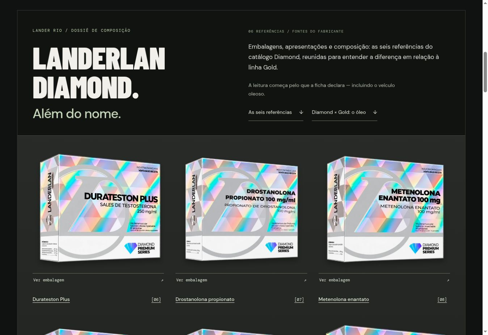
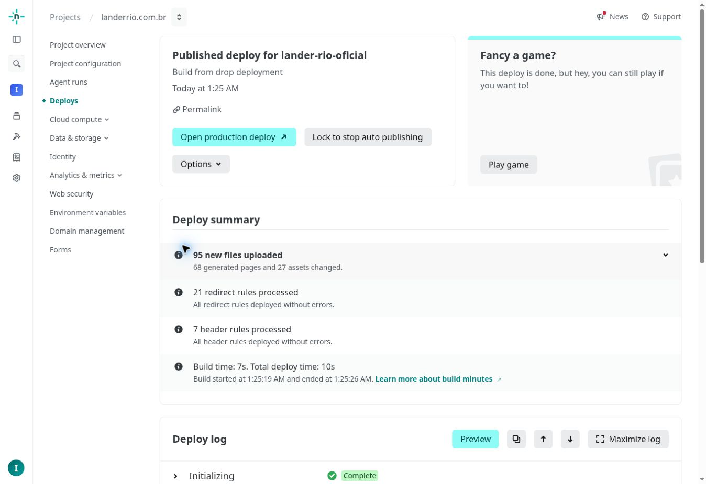

# Publicação RC14 — 15/11/2026

**Publicado e verificado:** [Landerlan Diamond × Gold](https://landerrio.com.br/marcas/landerlan/#diamond-gold).

## Identidade do artefato e do destino

| Campo | Valor confirmado |
|---|---|
| Projeto | `lander-rio-oficial` |
| Site ID | `1632727b-a57d-4edb-85f7-9fc99bc98842` |
| Origem | `site/` do commit `d77ce080e34178f28c731f4346849f59198dbe2c` |
| Árvore de origem | `23a94a6986153de541ac6f8b2541936b89bb892e` |
| Deploy anterior | `6af804d36034a689af84dddf` — RC10 |
| Deploy publicado | `6af9342e9b6477802a23ab4a` — RC14 |
| Estado | `ready`, contexto `production` |
| Publicado em | 2026-11-15 04:25:30.255 UTC / 01:25:30.255 America/Sao_Paulo |
| Arquivos no pacote | 307 |
| SHA-256 do ZIP | `ede8d899a28ff54c061e0ed936385efff5b7b59d087f3e01493a03ee7e1292d1` |

O usuário autorizou explicitamente a publicação. O painel exigiu restabelecer o login; o acesso foi concluído pelo fluxo seguro de autenticação. A versão foi enviada pelo controle de upload do projeto existente, em **um único deploy**. Nenhuma compra, alteração de DNS ou enfraquecimento de segurança foi realizado. O painel já indicava consumo superior a 75% da franquia; saldo exato e custo marginal não foram obtidos e não são estimados neste registro.

O pacote contém a versão integrada revisada, incluindo alterações anteriores das RC11–RC13. A Netlify informou 95 arquivos novos/alterados (68 páginas e 27 assets), 21 regras de redirecionamento e 7 regras de cabeçalho processadas sem erros. O deploy anterior e o novo não contêm funções Netlify.

## Verificação antes e depois

- **Antes:** 45/45 blocos técnicos e 64/64 verificações Chromium, incluindo larguras 320, 390, 768 e 1440 px. Evidências em `evidence/diamond-2026-11-15/editorial-section-v3/`.
- **Empacotamento:** todos os 307 arquivos corresponderam aos hashes Git da árvore aprovada; teste de integridade do ZIP aprovado. [Manifesto de envio](evidence/diamond-2026-11-15/publication/upload-artifact.json).
- **Hospedagem:** publicação confirmada no painel e no conector Netlify. [Metadados sem credenciais](evidence/diamond-2026-11-15/publication/netlify-deploy.json).
- **HTTP em produção:** 20/20 arquivos críticos retornaram HTTP 200 e SHA-256 idêntico ao artefato aprovado, incluindo home, página Landerlan, CSS da seção, release, manifesto, robots, sitemap, medição e as 12 imagens. [Resultados](evidence/diamond-2026-11-15/publication/production-http-verification.json).
- **Navegador em produção:** seis imagens decodificadas, 14 destinos de âncora existentes, um H1 e canonical correto. O link do óleo abriu `#oleo-composicao`; retorno à seção confirmado. [Inspeção](evidence/diamond-2026-11-15/publication/live-browser.json).
- Nenhum formulário, evento de compra, envio de WhatsApp ou transação comercial foi executado.

`release.json` e o manifesto publicados preservam os bytes validados do commit aprovado. Seus campos de candidata registram o estado **no momento da preparação**, antes da autorização e do envio; não são uma consulta ao estado da hospedagem. A publicação efetiva é documentada pelo deploy, timestamp, hashes e esta evidência. Nenhuma segunda publicação foi feita apenas para alterar esses metadados históricos.

## Evidência visual

## Limites que permanecem

As embalagens são imagens originais do catálogo do fabricante, publicadas como mockups, e não fotografias verificadas de unidades físicas. A composição dos outros cinco veículos permanece sem identificação nominal nas fontes consultadas. O conteúdo é educativo, sem oferta ou recomendação de uso. Quatro resultados axe de contraste continuam incompletos; Safari/iPhone físico, revisão clínica/regulatória externa e resultados de SEO não foram verificados.

O PR14 continua aberto sobre PR13; publicação manual e merge são estados distintos. Este registro não afirma aumento de tráfego, indexação nova, contatos ou vendas. Uma futura publicação deve partir da versão RC14 ou de sucessora reconciliada; a antiga `main` não representa este artefato.
